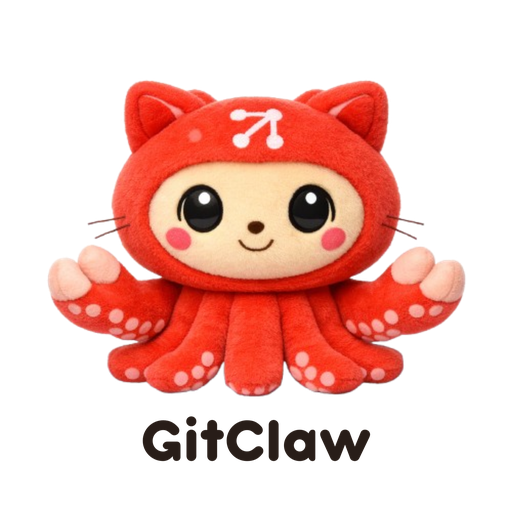
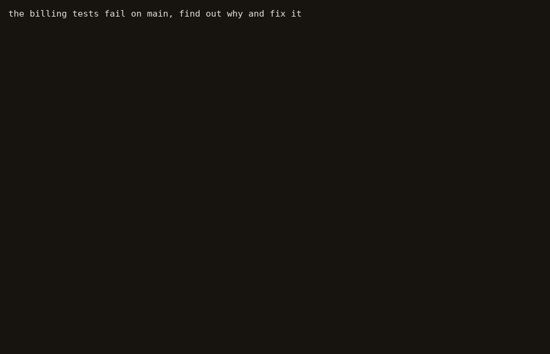
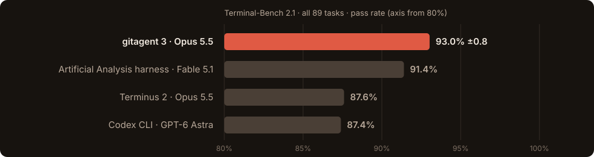
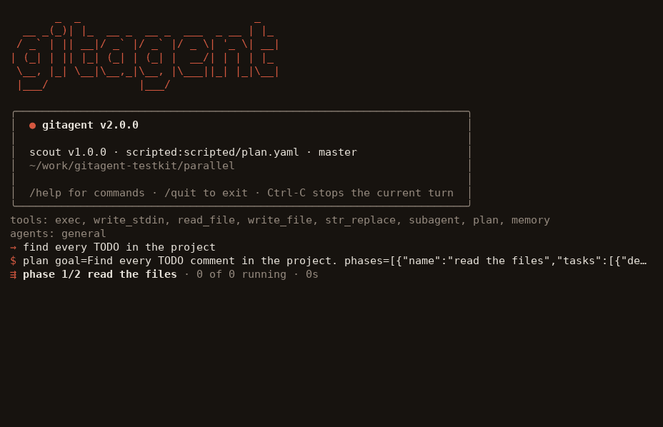

<p align="center">
  
</p>

<h1 align="center">gitagent</h1>

<p align="center">
  <strong>The agent that lives in a git repository.</strong><br/>
  One static binary. Its identity, rules, memory, skills, tools and schedules are files you commit.
</p>

<p align="center">
  
  
  
  
</p>

<p align="center">
  <a href="#why-gitagent">Why</a> &bull;
  <a href="#install">Install</a> &bull;
  <a href="#use">Use</a> &bull;
  <a href="#cli-options">CLI</a> &bull;
  <a href="#results">Results</a> &bull;
  <a href="#how-gitagent-works">How it works</a> &bull;
  <a href="#architecture">Architecture</a> &bull;
  <a href="#sdks-any-language-over-ipc">SDKs</a> &bull;
  <a href="#troubleshooting">Troubleshooting</a>
</p>

<p align="center">
  
</p>

**Terminal-Bench 2.1: 93.03% ±0.8** with Claude Opus 5.5, all 89 tasks, five runs each, code frozen at the published commit; the ± is the run-to-run variation, as on the official leaderboard. The published harnesses on the same benchmark: Terminus 2 with the same model 87.6%, Codex CLI with GPT-6 Astra 87.4%, Claude Code with Claude Fable 5 83.8%, and the highest published entry, Artificial Analysis's own harness with Claude Fable 5.1 at maximum effort, 91.4%. The numbers are under [Results](#results); the reason is under [How gitagent works](#how-gitagent-works).

## Why gitagent

Most agent frameworks treat the agent as code scattered across your application. gitagent flips this: **your agent is a git repository**.

- **`agent.yaml`**: model, tools, runtime settings, compliance
- **`SOUL.md`**: who the agent is
- **`RULES.md`**: what it must never do
- **`memory/`**: what it remembers, committed to git with full history
- **`skills/`**: instructions it can follow on demand
- **`tools/`**: tools declared in YAML, backed by any script
- **`hooks/`**: scripts that check or change every action
- **`schedules/`**, **`workflows/`**, **`agents/`**: when it works on its own, step-by-step procedures, sub-agents it delegates to

Fork an agent. Branch a personality. `git log` its memory. Diff its rules. Review a change to its behaviour like a code change. Every result traces back to a commit.

**gitagent 3** is the Rust rewrite: one static binary with no runtime to install, the harness that scored 93.03% on Terminal-Bench 2.1, a console in your terminal, parallel sub-agents with a live task board, and SDKs for Python, TypeScript and any other language over a simple line protocol. Agents, hooks, schedules and SDK code written for the TypeScript gitagent (1.x and 2.x) run unchanged, and agent folders in the OpenGAP format load too. See [Coming from the TypeScript gitagent](#coming-from-the-typescript-gitagent).

## Install

```sh
curl -fsSL https://raw.githubusercontent.com/open-gitagent/gitagent/main/scripts/install.sh | sh
```

This installs the binary for your system (Linux x86_64/arm64, macOS arm64/x86_64) into `~/.local/bin`; set `INSTALL_DIR` to change that. To build from source you need Rust (the version is pinned in `rust-toolchain.toml`):

```sh
cargo build --release            # ./target/release/gitagent
scripts/build-release.sh         # static Linux binaries (needs cargo-zigbuild on macOS)
```

## Use

Set the key for your model provider, then:

```sh
export ANTHROPIC_API_KEY=...

# One task in a folder; prints the agent's summary when done
gitagent -p "fix the failing test" --dir ./project --model anthropic:claude-opus-5-5

# Interactive: type tasks one per line; each continues the same session
gitagent --dir ./project --model anthropic:claude-opus-5-5

# Work in a fresh clone on a new branch, commit when done, push
GITHUB_TOKEN=... gitagent --repo https://github.com/org/app.git -p "fix the failing test" --push
```

In interactive mode, Ctrl-C stops the current task and Ctrl-D or `exit` quits.

### CLI options

`gitagent [OPTIONS] [PROMPT]`. Without a prompt it opens the console in `--dir`.

| Option | What it does |
|---|---|
| `[PROMPT]`, `-p, --prompt <text>` | The task, as plain words; runs it once and exits |
| `--instruction-file <file>` | Read the task from a file |
| `-d, --dir <dir>` | The agent folder to work in (default: the current directory) |
| `-m, --model <provider:model>` | The model; overrides `gitagent.yaml` |
| `-e, --env <name>` | Apply the agent's `config/<name>.yaml` (default: `GITAGENT_ENV`) |
| `--profile <name or path>` | `auto`, a built-in profile, or a profile file |
| `--config <file>` | A `gitagent.yaml` to use; its `prompts/` and `profiles/` override the built-ins |
| `--conversation` | A plain reply ends the run, instead of `task_complete` (always on in the console) |
| `--max-turns <n>` | Stop after this many model calls |
| `--timeout-s <seconds>` | Time limit for the run. Without one, the console has no limit and `-p` runs stop after 30 minutes |
| `--allowed-tools <a,b>`, `--disallowed-tools <a,b>` | Offer only these tools, or never these |
| `--append-system-prompt <text>` | Text added after the system prompt |
| `--workflow <name>`, `--input key=value` | Run one of the agent's workflows instead of a task |
| `-r, --repo <url>` | Work in a clone of the repository on a new branch, and commit the result |
| `--base <branch>`, `--branch <name>`, `--session <name>` | Repo mode: the branch to start from, or an existing branch to resume |
| `--push`, `--pat <token>` | Repo mode: push the branch after committing; the token to use (default: `GITAGENT_GIT_TOKEN`, `GITHUB_TOKEN` or `GIT_TOKEN`) |
| `--out-dir <dir>` | Where the trajectory, counters and logs go (default: `/tmp/gitagent`) |
| `--session-id <id>` | Session id recorded in the trajectory |
| `--events jsonl` | Print every step as a JSON object per line |
| `--output-format text \| stream-json` | Print the summary, or the SDK's messages one per line |
| `--ipc` | Serve the IPC protocol for a client library (see [SDKs](#sdks-any-language-over-ipc)) |
| `--bench` | Benchmark mode: built-in configuration only, no memory, no git commits |
| `--linger` | Keep the shells, and anything running in them, open after the run |
| `-V, --version`, `-h, --help` | Version and help |

Subcommands, each with its own `--help`:

| Command | What it does |
|---|---|
| `gitagent init [dir]` | Create an agent folder: `agent.yaml`, `SOUL.md`, `memory/`, a git repository |
| `gitagent validate [dir] [--compliance]` | Check an agent folder against the format, with file and line for every problem |
| `gitagent install [dir]` | Fetch the agent's `extends` parent and its `dependencies` |
| `gitagent plugin install\|list\|enable\|disable\|remove\|init` | Manage the agent's plugins |
| `gitagent schedule list\|add\|run\|start\|enable\|disable\|remove` | Manage and run the agent's schedules |
| `gitagent learn --from <runs>` | Learn lessons from finished runs |

In the console, `/help` lists the session's commands, and typing `/` shows them as you type.

### Models

`--model provider:model`, or `model:` in `gitagent.yaml`.

| Provider | Example | Key |
|---|---|---|
| Anthropic | `anthropic:claude-opus-5-5` | `ANTHROPIC_API_KEY` |
| OpenAI (Responses API) | `openai:<model>` | `OPENAI_API_KEY` |
| Google Gemini | `google:<model>` | `GEMINI_API_KEY` |
| Any OpenAI-compatible endpoint | `openrouter:<model>`, `ollama:<model>`, `vllm:<model>`, `<name>:<model>` | `{NAME}_API_KEY`; endpoint from `{NAME}_BASE_URL` (OpenRouter, Ollama and vLLM have defaults) |

The agent's shell never sees these keys.

### Repo mode

`--repo <url>` clones into `--dir` (default: `./<repo-name>`).

- **Branch:** it works on a new branch `gitagent/<task>-<id>` created from `--base` (default: the remote's default branch). `--branch <name>` continues an existing branch instead.
- **Commit:** when the agent finishes, it commits with the author from `gitagent.yaml`. Nothing is committed when nothing changed.
- **Push:** only with `--push`.
- **Safety:** it never commits to or pushes the base branch, and never force-pushes.
- **Token:** `GITAGENT_GIT_TOKEN` or `GITHUB_TOKEN` is passed to git through a helper. It is never written to the repository, the logs or the events.

### Parallel work

With `runtime: {parallel_tasks: true}` in agent.yaml, the agent gets a
`plan` tool: it writes phases of tasks, every task in a phase runs at the
same time as its own sub-agent (fresh context, own shell), a later phase
sees the earlier results, and one more sub-agent reconciles everything into
the answer. `runtime.max_parallel` (default 4) says how many run at once;
the next task starts as soon as one finishes. Use it for work that splits
into similar pieces: many files to read, many items to check. It costs
tokens in proportion, so give it scoped tasks.

`max_parallel` is a ceiling. When the model provider refuses a call for
rate limits, the call is retried after a backoff and the number of tasks
running at once is halved; after ten calls in a row go through, one slot
comes back, up to the ceiling. The task board says when this happens
("slowed to 2 at a time after 3 rate limits"), and every run counts its
`rate_limit_retries`. So set `max_parallel` to what you want when the
account allows it, and let gitagent slow down when it does not.

Each task gets 30 model calls unless the agent gives it its own
`max_turns` (up to 100), which it can size to the task: more for a large
review, fewer for a quick look-up. A task is warned when 80% of its calls
are used and again before its last one, so it hands back a summary rather
than stopping mid-step. One that still runs out shows as "out of turns,
partial" on the task board and is marked so in the results the agent sees.

```yaml
runtime:
  parallel_tasks: true
  max_parallel: 8
```

### Schedules

`schedules/*.yaml` in the agent directory are prompts the agent runs on a
timetable, as in gitagent 1.x:

```yaml
id: daily-triage
description: Morning ticket triage
cron: "0 8 * * 1-5"      # minute hour day month weekday, local time (six fields add seconds)
prompt: |
  Review the open tickets and save a summary to memory.
mode: repeat             # or once; `runAt: 2026-11-01T09:00:00Z` runs one time at a moment
enabled: true
```

```sh
gitagent schedule list -d ./project                      # with each one's next run
gitagent schedule add nightly --cron "0 2 * * *" --prompt "Tidy the notes." -d ./project
gitagent schedule run nightly -d ./project               # once, now
gitagent schedule start -d ./project                     # keep running; fires each schedule when due
gitagent schedule disable nightly -d ./project           # also enable, remove
```

`start` runs one job at a time, each as a fresh conversation, logs it to
`.gitagent/schedule-logs/<id>.jsonl` and records `lastRunAt` and
`lastResult` in the schedule's file (a `once` schedule is then turned off).
Like 1.x's in-process scheduler, jobs fire only while `start` is running;
for anything that must not be missed, have an external scheduler call
`gitagent schedule run <id>`.

## Results

<p align="center">
  
</p>

The headline run's logs are public: every trial of it, with its trajectory and verifier output, is on the Harbor hub, one job per time limit (links in the table below). The headline run and the published comparisons:

| Harness | Model | Terminal-Bench 2.1 | Runs per task | Source |
|---|---|---|---|---|
| **gitagent 3** | Claude Opus 5.5 | **93.03% ±0.8** (414/445; 75 of 89 tasks passed every run) | 5 | [job logs on the Harbor hub](#the-same-run-by-time-limit) |
| Terminus 2 | Claude Opus 5.5 | 87.6% | 1 | [Vals.ai](https://www.vals.ai/benchmarks/terminal-bench-2-1) |
| Codex CLI | GPT-6 Astra | 87.4% ±0.9 | — | [Snorkel, the official leaderboard](https://snorkel.ai/leaderboard/terminal-bench-2-1/) |
| Artificial Analysis's own harness | Claude Fable 5.1, max effort | 91.4% | — | [Artificial Analysis](https://artificialanalysis.ai/evaluations/terminalbench-2-1) |
| Claude Code | Claude Fable 5 | 83.8% ±1.2 | — | [Snorkel, the official leaderboard](https://snorkel.ai/leaderboard/terminal-bench-2-1/) |

Claude Code has no published Terminal-Bench 2.1 entry with Opus 5.5; the table shows its best published entry.

#### The same run by time limit

Pass@k is the chance that at least one of k runs passes:

| Time limit | Trials | Pass rate | pass@2 | pass@5 | Logs |
|---|---|---|---|---|---|
| 10 min | 5 | 100.0% | 100.0% | 100.0% | [job](https://hub.harborframework.com/jobs/c78a765b-7b37-41c8-b4b3-1b8c1d48ff44) |
| 12.5 min | 5 | 100.0% | 100.0% | 100.0% | [job](https://hub.harborframework.com/jobs/80c531b4-cc07-4c31-9b17-c329e6ab8195) |
| 15 min | 240 | 92.9% | 95.2% | 95.8% | [job](https://hub.harborframework.com/jobs/63bf2992-3fa9-464b-953d-e485576f7365) |
| 20 min | 25 | 100.0% | 100.0% | 100.0% | [job](https://hub.harborframework.com/jobs/535aafbc-8f4a-4257-b0d1-48680c3ceb79) |
| 30 min | 85 | 87.1% | 95.9% | 100.0% | [job](https://hub.harborframework.com/jobs/d2a97421-d057-4711-b8cc-0fefa35a84b0) |
| 40 min | 10 | 100.0% | 100.0% | 100.0% | [job](https://hub.harborframework.com/jobs/6c57fec8-d434-4020-b208-1a0769c9cf0e) |
| 60 min | 65 | 95.4% | 97.7% | 100.0% | [job](https://hub.harborframework.com/jobs/e1ea8dbd-7a55-4fa3-95de-b9338a3c1223) |
| 2 h | 5 | 100.0% | 100.0% | 100.0% | [job](https://hub.harborframework.com/jobs/127445ee-63ec-44c7-8206-189eb22cd912) |
| 3 h 20 min | 5 | 100.0% | 100.0% | 100.0% | [job](https://hub.harborframework.com/jobs/1d8e0bdb-7ae5-4ec7-8e54-329007590e9d) |
| **all** | **445** | **93.03% ±0.8** | | | |

Two of the 89 tasks start a virtual machine inside the container, which this host can't do, so every harness fails them here; without them the score is 95.2%. The ±0.8 is the run-to-run variation, the measure the official leaderboard uses: the five runs scored 93.3, 95.5, 92.1, 92.1 and 92.1%. The run cost $112.85, about $0.25 per run, with 91% of the input tokens served from the prompt cache.

### Why it scores higher than the other harnesses

On a benchmark like this one, a strong model solves most tasks with any reasonable harness. The gap between harnesses comes from a smaller set of hard tasks: long builds, services that must keep running, strict output formats, and tasks close to their time limit. On those, runs rarely fail because the model lacks the skill. They fail because the model stops too early, loses track in a long context, repeats itself, or runs out of time.

The model is the same across these comparisons, so the difference lies in what the harness does between model calls. gitagent addresses each of those failure modes directly. Four mechanisms account for most of the gain, and each was measured on its own on the benchmark before it was kept (see [How gitagent works](#how-gitagent-works) and the detail in [docs/HOW-IT-WORKS.md](./docs/HOW-IT-WORKS.md)).

#### 1. A task is finished only when there is evidence that it works

**The problem.** The most common way to lose a task is not failing to solve it, but believing it is solved when it is not. A model writes a fix, reads it back, finds it convincing, and declares the task complete without running anything. The hidden tests then disagree. Other harnesses at most ask the model to confirm, and a second "yes" from the same model adds little.

**What gitagent does.** It records every change the agent makes, such as a file write, an in-place edit or a package install, and every check it runs, such as a test suite, the program itself, or a request to a running service. When the model calls `task_complete` and the last change was not followed by a finished check, the call is refused. The model is told which change it never checked and is shown the task again. A task is sent back at most twice, and the check steps aside near the end of the time budget, when another round could no longer help.

**Why it helps.** The cost is one extra turn. On a run where the model was confident and wrong, that turn often turns a failure into a pass. The check never judges the work itself; it only asks that a verification actually ran, so it cannot make a correct run worse.

#### 2. The model reads less, and most of what it reads is cached

**The problem.** Two costs grow with every turn. The first is attention: a model searching a ten-thousand-line build log for the one line that matters does worse than a model shown the relevant part, and a long run accumulates many such logs. The second is cost and speed: every call re-sends the whole conversation, so without care the cost of a run grows much faster than its length.

**What gitagent does.**

- Every command result is cut to a budget of 8,000 tokens before the model sees it. The beginning, the end and the exit code are kept, and runs of similar lines are folded into one. The full output is saved to a file the model can open if it needs more.
- Old tool results are cleared in batches through the provider's own context editing once the conversation grows past 50,000 tokens.
- Reminders, such as the time left, are added at the end of the conversation and never written into earlier turns.

**Why it helps.** The last rule matters more than it seems. Providers cache the start of a conversation, and any change to an earlier message invalidates the cache from that point on. Because gitagent never rewrites history, 91% of the input tokens in the published run were served from the cache. That makes each call faster, and on Opus 5.5 a cache read costs a twentieth of normal input. The model's attention stays on recent, relevant output.

#### 3. The harness keeps track of time and repetition

**The problem.** In long runs, models are poor at two things: noticing that they are repeating themselves, and pacing their work against a clock they cannot see. A model can retry the same failing command until the time limit, and a run that times out scores zero even when the work was nearly done.

**What gitagent does.** When the same command with the same arguments returns the same output three times, gitagent tells the model plainly that it is repeating itself and should change approach. Every tool result also shows the minutes remaining. At 70% of the budget the model is reminded to wrap up, and at 90% it is told to finish now.

**Why it helps.** A loop is broken after three repetitions instead of running until the deadline. A finished and checked result, even a partial one, often passes, where an unfinished one never does. Runs rarely end in a timeout; none of the 445 trials in the published run did.

#### 4. The environment is surveyed once, before the first step

**The problem.** Without help, the first turns of almost every run go to orientation: listing directories, checking language versions, looking for a compiler, checking memory. Each of those is a full model call.

**What gitagent does.** Before the first model call, gitagent runs a single probe of at most fifteen seconds, outside the agent's shell. It collects the working directory listing, the operating system, the CPU and memory, and the versions of common tools, and puts the result in the first message.

**Why it helps.** The model starts on the task with the facts it would otherwise spend several turns gathering. On tasks with short time limits, those turns are real slack.

#### How the four work together

None of these makes the model more capable. Together they remove the ways a capable model loses a task it could have solved: stopping too early, losing focus in long output, repeating itself, running out of time, and spending its opening turns on orientation. They also reinforce each other. A smaller context makes loops easier to escape, the time reminders leave room for the completion check to send work back before the deadline, and the cache savings make the extra verification turns nearly free.

Outside benchmarks, the same mechanisms are on by default, with two differences. The time reminders appear only when a run has a time limit, and the environment probe stays a benchmark setting. See [Configuration](#configuration).

**The rules behind the numbers** (`docs/INTEGRITY.md`, checked by `scripts/integrity-audit.sh`): the agent never reads a task's tests or verifier output, and a built-in guard refuses writes under `/tests`; the tasks used while developing were kept apart from the ones used to score; benchmark mode uses only the built-in configuration, with a test that fails if the prompt or tool list sent to the model ever changes.

## How gitagent works

Most agents are a prompt, a model and a bag of tools, and the interesting part is what happens in between: how the agent is kept on course for an hour of work inside a context window, without wasting the model's attention and without breaking its cache. That in-between is what gitagent is. Here is one run, start to finish.

**The agent is a folder.** Before anything runs, the loader reads the agent directory: `agent.yaml` for the model and the tools, `SOUL.md` for who it is, `RULES.md` for what it must never do, `memory/` for what it remembers, `skills/`, `hooks/`, `schedules/`, `agents/` for the rest. All of it is assembled into one system prompt in a fixed order, and all of it is in git, so the agent that produced a result is a commit you can check out. The same loader runs the console, the SDKs and a single task; only the files differ.

**The prompt is a method.** It does not describe a character. It says how to work: note every concrete requirement in the task before touching anything, explore the environment, change things in small steps and check each one, and at the end verify the result by exercising it, running the tests, the program or the request. That last instruction is where most agents go wrong: the model finishes without proof, and the result does not hold.

**One loop, one shell.** The model is called with the prompt, the task and the history. It answers with text or tool calls. The tools run in one persistent shell, so working directory, environment and background processes carry from turn to turn like a person's terminal. The results go back; the loop repeats until the model calls `task_complete`.

**Output is shaped before the model sees it.** A build log is ten thousand lines; the model needs the head, the tail and the exit code. Every command result is cut to a budget: long output is spilled to a file, runs of similar lines (progress bars, repeated warnings) collapse to their first and last line, and a one-line status carries the exit code, the line count and the path of the spill file, so the model can ask for the rest if it matters. Fewer tokens per turn means more turns before the context is full, and more of each turn spent on the task.

**Reminders are appended, never injected.** The time left is shown on every result, and a reminder fires when the budget runs low. These go after the turn's results, never into earlier turns. Changing an earlier turn would invalidate the provider's prompt cache and the model's thinking blocks, so the whole history stays byte-identical and 91% of the input is served from cache. That is where the cost per run comes from.

**The loop detector.** If the model makes the same tool call with the same arguments and gets the same output three times in a row, it is told so and asked to change approach. Runaway loops are where other harnesses burn a time budget and a bill: a model that returns empty replies can be re-sent the whole growing conversation until the clock runs out. gitagent breaks the loop at the third identical call.

**Context is managed, not truncated.** Old tool results are cleared in batches through the provider's own context editing. Each clear invalidates the cache from the point it clears, so clearing waits until the prompt is large and then removes a lot at once. Near the end of the window the history is replaced by a structured summary, done, pending, key files, last failure, ruled out, with the original task repeated verbatim by the harness rather than paraphrased by the model, so the goal never drifts.

**Done means verified.** `task_complete` is accepted only when the run shows a verification after the last edit. A completion without evidence is sent back with the task repeated. It is a small rule with a large effect: it catches the case where the model is confident and wrong.

**Services can stay up.** With `--linger` the agent's shells are kept open after it finishes, so a server it started keeps serving whoever needs it next.

**Every run is a record.** Each run writes a trajectory in the ATIF format, every prompt, reply, tool call and result, plus counters for every decision the loop made: loops caught, completions rejected, context compacted, cache hits. A failed run can be read step by step, and a change to the harness can be measured run by run against the previous one.

The pieces are ordinary. What is unusual is that each one is a switch in a profile file, measured on its own before it stayed on, and that the whole thing ships as one static binary that runs the same way in a container, in your terminal and behind the SDK. The exact mechanics, with the numbers, formats and algorithms, are in [docs/HOW-IT-WORKS.md](./docs/HOW-IT-WORKS.md).

<p align="center">
  
</p>

**Parallel work.** When a task has many similar pieces, the agent can write a plan of phases: every task in a phase runs at the same time as its own sub-agent, a later phase sees the earlier results, and one more sub-agent reconciles everything into the answer. The console shows it as a board that redraws as the tasks run. See [Parallel work](#parallel-work).

## Architecture

```
my-agent/
├── agent.yaml          # model, tools, runtime, compliance, plugins
├── SOUL.md             # identity
├── RULES.md            # hard rules
├── DUTIES.md           # role and responsibilities
├── memory/
│   ├── MEMORY.md       # working memory, committed on every save
│   └── memory.yaml     # optional layers and line limits
├── skills/
│   └── <name>/SKILL.md # instructions with YAML frontmatter, plus any files
├── tools/
│   └── <name>.yaml     # declarative tools backed by a script or HTTP call
├── hooks/
│   ├── hooks.yaml      # scripts per lifecycle event
│   ├── bootstrap.md    # what to do when a session starts
│   └── teardown.md     # what to do when it ends
├── agents/
│   └── <name>/         # sub-agents, each a full agent folder
├── workflows/
│   └── <name>.yaml     # step-by-step procedures, run with @<name>
├── schedules/
│   └── <name>.yaml     # prompts on a timetable
├── knowledge/
│   └── index.yaml      # reference documents, some always loaded
├── examples/
│   └── *.md            # worked examples for the prompt
├── plugins/
│   └── <name>/         # local plugins: tools, skills, hooks, prompt text
├── config/
│   ├── default.yaml    # settings for every environment
│   └── <env>.yaml      # overrides for --env <env>
└── .gitagent/          # runtime state, not committed: sessions, audit, schedule logs
```

The binary reads this folder on every start, assembles one system prompt from it in a fixed order (identity, working method, skills, sub-agents, workflows, knowledge, examples, compliance, memory), and runs the loop described in [How gitagent works](#how-gitagent-works). `gitagent init <dir>` creates a minimal folder; `gitagent validate <dir>` checks one against the format.

### The agent manifest (`agent.yaml`)

```yaml
spec_version: "0.1.0"
name: lyra
version: 1.0.0
description: Keeps the billing service healthy.

model:
  preferred: anthropic:claude-sonnet-5-5
  fallback: [openai:gpt-6-astra]
  constraints: {temperature: 0.2, max_tokens: 8000}

tools: [cli, read, write, memory, word-count]   # built-ins by their 1.x names, plus tools/*.yaml

runtime:
  max_turns: 50
  timeout: 120            # seconds a command may run before it goes to the background
  parallel_tasks: true    # the plan tool: phases of sub-agents, then a reconciling step
  max_parallel: 4

# Optional
extends: https://github.com/org/base-agent.git    # inherit another agent's files
dependencies: [{name: shared, source: https://github.com/org/shared-agent.git, version: main, mount: agents/shared}]   # gitagent install
skills: [release-notes]
agents: {reviewer: {description: Reviews a change for bugs.}}
mcp_servers: {notes: {command: python3, args: [notes-server.py]}}
plugins: {greeter: {enabled: true}}
compliance:
  risk_tier: high
  supervision: {human_in_the_loop: conditional, escalation_triggers: [{action_type: cli}]}
  recordkeeping: {audit_logging: true}
```

Built-in tools: `cli` (a persistent shell), `read`, `write`, `edit`, `memory`, and on request `skill`, `subagent`, `plan`, `workflow`. Tools from `tools/*.yaml`, plugins and MCP servers are added by name. The model sees the built-ins under their native names (`exec`, `read_file`, …); everything a person writes, hooks and SDK messages included, uses the 1.x names.

## SDKs: any language over IPC

The agent always runs in the binary. A client library starts `gitagent --ipc`, writes JSON lines to its stdin and reads JSON lines from its stdout. That is the whole interface, so any language that can start a process and read lines can drive an agent. The Python and TypeScript clients are thin wrappers over it.

### Python

```sh
pip install ./clients/python        # from this repository; needs `gitagent` on PATH or GITAGENT_BIN
```

```python
from gitagent import query, tool

lookup = tool("lookup_order", "Looks up an order.",
              {"properties": {"id": {"type": "string"}}},
              lambda args: f"Order {args['id']} shipped on Monday.")

q = query("Where is order 42?", dir="./my-agent", tools=[lookup],
          hooks={"pre_tool_use": lambda ctx: {"action": "allow"}},
          approver=lambda req: input(f"approve {req['toolName']}? [y/N] ") == "y")
for message in q:
    if message["type"] == "assistant" and message["content"]:
        print(message["content"])
print(q.result()["outcome"], q.costs())
```

`q.send(text)` adds a turn, `q.steer(text)` speaks to the running one, `q.abort()` stops it, `q.end()` ends the session. All options are listed in [clients/python/README.md](./clients/python/README.md).

### TypeScript

```sh
npm install ./clients/typescript    # from this repository; needs `gitagent` on PATH or GITAGENT_BIN
```

```ts
import { query, tool } from "@open-gitagent/gitagent";

const lookup = tool("lookup_order", "Looks up an order.",
  { properties: { id: { type: "string" } } },
  async (args) => `Order ${args.id} shipped on Monday.`);

const q = query({ prompt: "Where is order 42?", dir: "./my-agent", tools: [lookup],
  hooks: { preToolUse: () => ({ action: "allow" }) } });
for await (const message of q) {
  if (message.type === "assistant" && message.content) console.log(message.content);
}
console.log(q.result()?.outcome, q.costs());
```

The API is the TypeScript gitagent's `query()`, so existing code keeps working: messages, hooks and options have the same names, and tools appear under their 1.x names (`cli`, `read`, …). See [clients/typescript/README.md](./clients/typescript/README.md).

### Any other language

Start `gitagent --ipc`, send `initialize`, then one `user` message per turn. This is a complete client in bash:

```bash
coproc GA { gitagent --ipc; }
send() { printf '%s\n' "$1" >&"${GA[1]}"; }
send '{"type":"initialize","protocol":1,"options":{"dir":"./my-agent","toolNames":"v1"}}'
send '{"type":"user","content":"The billing tests fail on main. Find out why and fix it."}'
while IFS= read -r line <&"${GA[0]}"; do
  case "$(jq -r '.type + "/" + (.subtype // "")' <<<"$line")" in
    tool_use/)          jq -r '"$ " + .toolName + " " + (.args | tostring)' <<<"$line" ;;
    assistant/)         jq -r 'select(.content != "") | .content' <<<"$line" ;;
    system/turn_end)    send '{"type":"end"}' ;;
    system/session_end) break ;;
  esac
done
```

| You send | It means |
|---|---|
| `{"type":"initialize","protocol":1,"options":{…},"callbacks":[…],"tools":[…]}` | Start. Options: `dir`, `model`, `env`, `systemPrompt`, `allowedTools`, `maxTurns`, `sessionId`, `resume`, `mcpServers`, `repo`, `conversation`, `toolNames`, … `callbacks` names the hooks your code answers (`preToolUse`, `postToolUse`, `approval`, …); `tools` declares tools your code runs |
| `{"type":"user","content":"…"}` | A turn |
| `{"type":"steer","content":"…"}` | Words for the running turn |
| `{"type":"abort"}` / `{"type":"kill"}` | Stop the turn / stop and end the session |
| `{"type":"callback_response","id":"…","result":{…}}` | Your answer to a hook, tool or approval request |
| `{"type":"end"}` | End the session after the current step |

| You receive | When |
|---|---|
| `system/ready`, `system/session_start` | After `initialize`: the session id, the agent, the model, the tools |
| `user`, `delta`, `assistant`, `tool_use`, `tool_result` | As the turn runs; `assistant` carries `usage` and `costUsd` |
| `callback_request` (`kind`: `hook`, `tool` or `approval`) | The binary needs your answer; reply with `callback_response` and the same `id` |
| `system/turn_end` | A turn finished, with its `outcome` and usage |
| `system/warning`, `system/error`, `system/hook_blocked` | Something to show; the session goes on unless the error was fatal |
| `system/session_end` | Last message, with the session's costs |

With `resume: true` the conversation is stored after every turn under `.gitagent/sessions/<sessionId>/`, and a new process started with the same `sessionId` continues it.

### Rust


The `gitagent-sdk` crate runs the loop in your own process, without IPC: `query(prompt, AgentOptions)` streams `system` / `assistant` / `user` / `result` messages, tools appear under the `.claude/` tool names (`Bash`, `Read`, `Edit`, …), and hooks are callbacks that receive `PreToolUse` / `PostToolUse` input and answer with `permissionDecision`, `updatedInput` or `updatedToolOutput`.

```rust
use gitagent_sdk::{query, AgentOptions, AgentDefinition, HookEvent, HookMatcher, HookOutput, Message};

let mut q = query("Fix the failing test.", AgentOptions {
    model: Some("claude-opus-5-5".into()),
    allowed_tools: vec!["Bash".into(), "Read".into(), "Edit".into()],
    max_turns: Some(40),
    hooks: vec![HookMatcher::new(HookEvent::PreToolUse, Some("Bash"), |input| async move {
        if input.tool_input["command"].as_str().unwrap_or("").contains("rm -rf") {
            HookOutput::deny("no rm -rf")
        } else {
            HookOutput::allow()
        }
    })],
    ..Default::default()
}).await?;
while let Some(message) = q.next().await {
    if let Message::Result { result, total_cost_usd, .. } = &message {
        println!("{result:?} (${total_cost_usd:.2})");
    }
}
```

The same shape is available from the command line: `gitagent -p "..." --output-format stream-json` prints one message per line, and `--max-turns`, `--allowed-tools`, `--disallowed-tools` and `--append-system-prompt` take the same values as `AgentOptions`.

## Coming from the TypeScript gitagent

gitagent 3 replaces the TypeScript packages (1.x and 2.x) with one binary. What carries over unchanged:

- **Agent folders.** `agent.yaml`, `SOUL.md`, `RULES.md`, `memory/`, `skills/`, `tools/`, `hooks/`, `schedules/`, `workflows/`, `agents/`, `config/` and `.env` are read as they were. 1.x settings such as `tools: [cli, read, write, memory]`, `runtime.timeout` and the 1.x `compliance` shape are accepted; `gitagent validate` points out the newer spelling as a warning, never an error.
- **Hook scripts.** They get the same JSON and answer the same way; output that is not an answer, or a script that crashes, allows the action with a warning, as before. Only hooks marked `compliance: true` or `fail_open: false`, which are new, block in those cases.
- **The CLI.** `gitagent`, `-p`, `-d`, `-m`, `-e`, `--repo`, `--pat`, `--session` and the REPL's slash commands work as before.
- **SDK code.** `query()`, `tool()`, hooks, `steer()`, `abort()`, the message types and the `repo` option are the same; the TypeScript package now needs the `gitagent` binary installed.

What changed: the binary must be installed (one `curl` line, above); `--voice` and the remote `--sandbox` are not part of gitagent 3; a plugin's `entry` JavaScript is not run (plugins contribute tools, skills, hooks and prompt text through files); usage errors exit with 2, provider failures with 3 and interrupts with 130 instead of 1.

## Configuration

gitagent reads `gitagent.yaml` from `--config`, else the project folder (`gitagent.yaml` or `.gitagent/gitagent.yaml`), else `~/.gitagent/gitagent.yaml`. The other files are looked up one by one in the same places (the config's folder, the project's `.gitagent/`, then `~/.gitagent/`, then the project's and home `.claude/`), and fall back to the built-in versions:

| Path | What it is |
|---|---|
| `gitagent.yaml` | Model, turn and time limits, profile, sandbox, skills, hooks, learning, repo-mode settings |
| `prompts/system.md`, `prompts/rules.md` | The system prompt; `rules.md` is appended to it |
| `profiles/<family>.yaml` | Per-model-family settings: tools, effort, output shaping, caching, and the optional features below |
| `skills/<name>/SKILL.md` | Instructions the agent can load on demand; their names and descriptions are listed in the system prompt |
| `hooks/pre_tool_use`, `hooks/post_tool_use` | Scripts that receive each tool call (and its output) as JSON and answer `allow`, `block` or `modify` |
| `prompts/lessons.md` | Learned lessons appended to the system prompt; unlike the other files, every layer's lessons are added up |
| `agents/<name>.md` | Sub-agent definitions (`name`, `description`, `tools`, `disallowedTools`, `maxTurns`, `model`, `effort`; the body is the prompt), when the profile enables sub-agents |
| `.claude/agents/`, `.claude/skills/`, `.claude/settings.json` | An existing `.claude/` project layout, read as it is after the layers above: sub-agents and skills, and `PreToolUse` / `PostToolUse` hooks with their matchers, stdin JSON, exit codes and `hookSpecificOutput` answers (tool and argument names are translated both ways) |

`profile: auto` picks `anthropic`, `openai`, `google` or `compat` from the model's provider. Every behavior that changes results is a switch in the profile. The defaults for everyday work:

- **On:** output shaping, context compaction, the loop detector, the turn warning (at 80% of `max_turns` and before the last model call), and the stop check for runs that end with `task_complete` (`-p` and SDK task mode; a reply ends a console turn, so it never fires there).
- **On for Claude models:** old tool results are cleared by the provider once the conversation passes 50,000 tokens.
- **On when the run has a time limit:** the minutes left on every result, a reminder at 70% of the limit and a final call at 90%.
- **Benchmark profiles only:** the environment snapshot, which adds up to 15 seconds to each start.

**Time limits.** Everyday work needs none. In the console a turn runs until it is done or you press Ctrl-C. Runs nobody watches (`-p`, schedules, the SDKs) stop after 30 minutes unless you set another limit with `timeout_s` in `gitagent.yaml`, `--timeout-s`, or `timeoutMs` over IPC. Setting `timeout_s` applies to the console too.

With `learning: online`, gitagent learns from each task it completes. The model reads the run's trajectory and proposes general lessons, which are saved in the project's `.gitagent/prompts/lessons.md`. A lesson is used only once two different tasks support it. Review the file like code: edit or delete lines freely. In repo mode the lessons are committed separately on the branch. `--bench` never learns and never loads project lessons.

### Output, records and events

- **Records:** every run writes `trajectory.json` (the ATIF trajectory format), `counters.json` and the full output of every command (`out/<n>.log`) to `--out-dir`. They are updated after every turn. The console gives each session its own folder, `console-<time>-<pid>/task-<n>/`, and prints its path at the start.
- **Events:** `--events jsonl` prints one JSON object per line on stdout: `turn_start`, `model_text`, `tool_call`, `tool_result`, `stop_check`, `guard`, `turn_end`, `repo`, `run_end`.
- **Telemetry:** set `OTEL_EXPORTER_OTLP_ENDPOINT` to export traces and metrics (OTLP over HTTP/JSON). `OTEL_EXPORTER_OTLP_HEADERS` and `OTEL_SERVICE_NAME` are honoured.

### Sandbox

On Linux, outside benchmark runs, the agent's shell runs under Landlock: it may write only to the working folder, the output folder, the temp folders and `~/.cache`. A seccomp filter blocks system calls such as `mount`, loading kernel modules and `reboot`. Set `sandbox: off` in `gitagent.yaml` to disable it, or `sandbox: on` to require it. In benchmark runs, writing under `/tests` is refused; elsewhere `/tests` is an ordinary path.

## Terminal-Bench with Harbor

```sh
scripts/build-release.sh
PYTHONPATH=$PWD harbor run -d terminal-bench/terminal-bench-2-1 \
  -a gitagent_harbor.agent:GitAgent -m anthropic/claude-opus-5-5 \
  --env-file .env --ak timeout_s=840 \
  --ak profile=$PWD/bench/profiles/anthropic-m4-nolessons.yaml -k 3 -n 8 -o bench/jobs
```

The profile is the one the published run used. Each task sets its own time limit in its `task.toml`. Harbor stops the agent at that limit, but the shim is not given it, so the limit is passed in with `timeout_s`: the task's limit minus 60 seconds, so gitagent finishes its work and its records before Harbor cuts it off. The example suits the tasks with the common 15-minute limit. `scripts/run-dev-pass.sh` handles every limit: it reads each task's limit, starts one Harbor job per limit, and passes the matching `timeout_s`. That is why the published run has one job per time limit.

The shim (`gitagent_harbor/agent.py`):

- **Install:** uploads the static binary for the container's CPU and runs it with `--bench`, which uses only the built-in configuration.
- **After the run:** keeps the agent's shells open, so services it started are still up when the tests run, and returns once the agent is done.
- **Shim settings** (via `--ak`): `profile=<name or path>`, `timeout_s=<seconds>`.

`docs/INTEGRITY.md` lists the rules that keep results honest, and `scripts/integrity-audit.sh` checks them.

`python3 scripts/dashboard.py` serves a local dashboard over `bench/jobs` at http://127.0.0.1:8731, refreshing live while runs are going: jobs and trials (agent, oracle and baseline runs kept apart), accuracy per task, why each trial failed, every counter with its meaning, the guard and loop events in a trajectory, each trial's commands, outputs and log, the lesson store, the task catalog with difficulty and limits, and the feature switches of every profile. It reads only gitagent's own files, each trial's reward and the tasks' task.toml metadata.

### Learning from finished runs

`gitagent learn` turns finished runs into general lessons for the system prompt. It reads only gitagent's own trajectory and the reward of each trial, asks the model for lesson changes, rejects any that carry task details, and rewrites `prompts/lessons.md`. A lesson is shown to the agent only once attempts at two different tasks support it.

```sh
gitagent learn --model anthropic:claude-opus-5-5 --from bench/jobs/<job> [--from …] [--dry-run]
```

It learns only from tasks listed under `dev` in a split file (`--split`, default `bench/split.json`); the split used for the benchmark stays on the benchmark machine, outside the repository. Review the diff of `prompts/lessons.md` before committing it; set `lessons: false` in a profile to leave lessons out.

## Troubleshooting

**`gitagent: command not found`.** The installer puts the binary in `~/.local/bin`. Add it to your `PATH`, or run it by its full path.

**The agent does not answer, or exits with code 3.** The call to the model provider failed. Check that the key for your provider is set: `ANTHROPIC_API_KEY`, `OPENAI_API_KEY`, `GEMINI_API_KEY`, or `{NAME}_API_KEY` for an OpenAI-compatible endpoint. Keys can also live in the agent folder's `.env` or in `~/.gitagent/.env`. The line gitagent prints when it starts names the model it is using.

**My files are not being used.** Run `gitagent validate <dir>`: it lists every problem with a file and line number. Warnings at startup (`gitagent: warning: …`) name files that were skipped.

**A command or file write is refused.** On Linux the agent's shell runs in a sandbox that allows writes only under the working folder, the output folder, the temp folders and `~/.cache`. Set `sandbox: off` in `gitagent.yaml` if the agent must write elsewhere. A hook may also have blocked the action; the `$` line says so in its result.

**The session pauses with `! approval needed`.** The agent's compliance settings ask a person for that action. Answer `y` or `n`. Without a terminal, for example in a pipe, such requests are denied.

**Output looks garbled, or the prompt behaves oddly.** Set `NO_COLOR=1` to turn colour off. Piped input is read line by line without the line editor, which suits scripts.

**A command's output was cut.** The model sees a shaped version; the full output is in the run's output folder (`/tmp/gitagent` by default, `--out-dir` to change it), under `out/<n>.log`.

**How do I see what the agent did?** Every run writes `trajectory.json` (every prompt, reply, tool call and result) and `counters.json` to its output folder. `--events jsonl` prints each step as it happens, and `OTEL_EXPORTER_OTLP_ENDPOINT` exports traces and metrics.

**A conversation was lost when the process ended.** Sessions are kept across processes over IPC with `resume: true` and a fixed `sessionId`. In the console, `/new` starts a fresh conversation on purpose; nothing else drops it.

**Still stuck?** Open an issue at [github.com/open-gitagent/gitagent/issues](https://github.com/open-gitagent/gitagent/issues) with what you ran, `gitagent --version` and, if you can, the run's `trajectory.json`.

## Contributing

Contributions are welcome. See [CONTRIBUTING.md](./CONTRIBUTING.md) for how to build, test and send a change.

## Development

```sh
cargo fmt --all
cargo clippy --all-targets -- -D warnings
cargo test --workspace
```

The tests need no network or keys: a scripted provider replays model replies from YAML, and the provider adapters are tested against local mock servers.

- [BLUEPRINT.md](./BLUEPRINT.md): what is built and why.
- [docs/HOW-IT-WORKS.md](./docs/HOW-IT-WORKS.md): the mechanics, with numbers and formats.
- [docs/INTEGRITY.md](./docs/INTEGRITY.md): the rules that keep benchmark results honest, and the audit that checks them.

## License

[MIT](./LICENSE)
